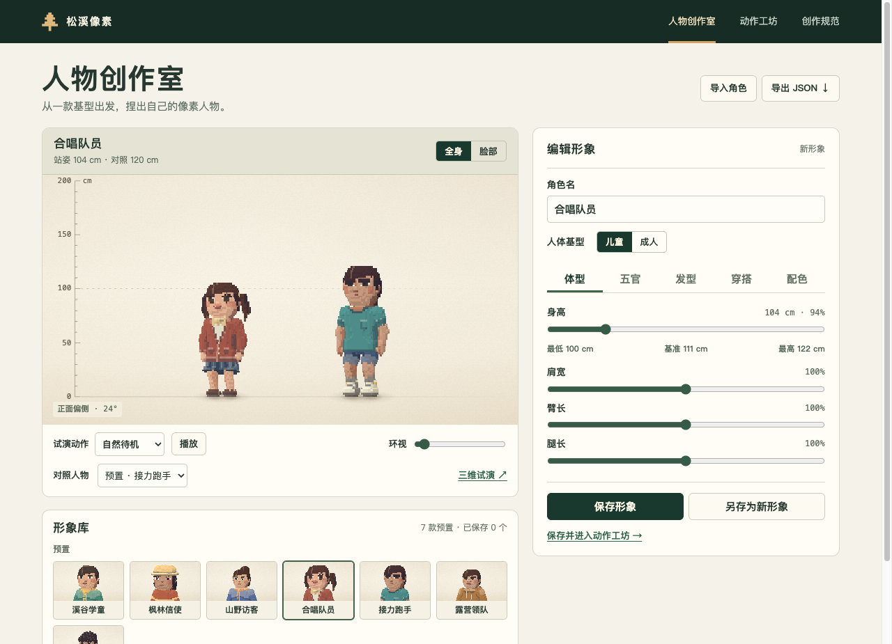

# 松溪像素人物 · Pine Pixel People

用二维像素切片制作可 360° 环视的人物。可以捏脸、组合服饰、保存形象，让不同身材的角色使用同一套动作。项目包含 Canvas 2D 创作室、动作编排器，以及可以装进 Three.js 场景的人物适配器。



## 本地运行

在仓库根目录启动静态 HTTP 服务，无需构建或安装前端依赖。Three.js 随项目分发。

```sh
python3 -m http.server 8000 --bind 127.0.0.1
```

- [人物创作室](http://127.0.0.1:8000/atelier.html)可以调整体型和五官、选择衣服和配色，也能并排对照两个人物。
- [动作工坊](http://127.0.0.1:8000/studio.html)可以更换演员、编排动作、指定时长和重复次数，保存循环编排。
- [Three.js 观景台](http://127.0.0.1:8000/three.html)用 WebGL 2 显示相同的演员与动作。创作室的「三维试演」会带入当前形象与搭档。
- [原始切片演示](http://127.0.0.1:8000/slice-study.html)可以旋转最初的徒步者，检查身体任一高度的像素横截面。

## 试演两个独立的形象

1. 打开创作室，选择儿童或成人基型。调整身高、肩宽、肢体比例、脸宽、眼距、下颌和嘴高，再选穿搭及七个基础颜色。
2. 在「发型」从后侧比较单马尾、双马尾与编发，在「五官」选一组眼眉鼻唇，再单独微调。「穿搭」提供四套可拆开搭配的服装。
3. 给人物取名并保存。改变发型或服装，再点「另存为新形象」。两个存档拥有各自的稳定 ID。
4. 用「对照人物」选择另一个形象，试跑或相互击掌。导出角色 JSON 可以在另一台设备重新打开，文件内含所穿外部帽饰的版本、素材和声明。
5. 也可以直接把 [放学后的双人编排](packs/after-school.json) 导入动作工坊，试看跑步、跳跃、击掌与喝水的完整循环。

全身镜头有固定的地面和厘米标尺。身高读数取站直时的裸头顶位置，换发型或戴帽时可以分别看到身体和头饰的高度。可直接打开[两位新角色的身高对照](http://127.0.0.1:8000/atelier.html?preset=look_chorus&compare=look_relay&tab=shape)或[双马尾的后侧近景](http://127.0.0.1:8000/atelier.html?preset=look_chorus&tab=hair)。

## 角色与动作怎样复用

先确定骨长与关节，再在各部位的局部坐标中绘制体积。在每个姿势中，用格点采样身体和衣服。Canvas 路径按观察方向层叠像素切片。Three.js 适配器提取同一份格点的可见表面，支持遮挡和阴影。角色导出的是参数和部件引用，动作由独立的采样器根据骨架、标签与接触点重建姿势。

内置演员有徒步者、测绘员、妈妈、儿童、学步幼儿和宝宝，共 16 个动作。v1 开放成人与儿童两种可编辑基型，各适配 13 个动作。亲子抱摇和躲猫猫使用已校准的妈妈与宝宝。外部创作者可通过 JSON 添加帽子。基础部件 1.1.0 提供 7 款发型、5 款上衣、4 款下装、4 款鞋和 3 种颈饰选择。眼、眉、鼻和唇各有 4 款。1.0.0 形象继续按原版本还原。

| 想做的事 | 文档或示例 |
| --- | --- |
| 编写和验证形象 | [形象与部件规范](appearance-standard.html) · [角色 Schema](character-v1.schema.json) · [溪谷学童](packs/creek-child.json) · [枫林信使](packs/maple-child.json) · [双马尾合唱队员](packs/chorus-child.json) · [单马尾接力跑手](packs/relay-child.json) |
| 贡献一顶帽子 | [溪谷帽饰 JSON 原稿](packs/creek-hats.json) · [部件包 Schema](part-pack-v1.schema.json) |
| 贡献动作或导出编排 | [骨架、接触点与动作 API](motion-standard.html) · [动作编排 Schema](score-v1.schema.json) · [可移植角色编排包 Schema](cast-v1.schema.json) |
| 接入 Three.js | [人物适配器](pine-three.mjs) · [示例集成](three-demo.mjs) |

## 兼容性检查

使用 Node.js 22 或更新版本。在项目根目录运行以下检查。第三项调用本机 Chrome，Linux 默认使用 google-chrome，可通过 CHROME_BIN 指定可执行文件。GitHub Actions 在推送和拉取请求时运行这三项检查。

```sh
node check-motion.cjs
node check-appearance.cjs
node tests/check-atelier.cjs
```

检查涵盖内置动作与演员标签、时序和接触点，还会在独立运行环境中验证形象的逐像素还原、部件版本和冲突处理。贡献新帽子时应为新版本保留唯一的包名与版本组合，分别检查儿童和成人佩戴时的正面、侧面与后脑。

## 许可

本项目原创工具、人物、部件、动作、场景及示例按 [MIT 许可证](LICENSE) 分发。版权为 2026 zhangran653 and contributors。复制或分发时请保留版权与许可声明。随附 Three.js r187 与 OrbitControls 的版权属于 three.js authors，[上游许可](vendor/three-r187/LICENSE) 已保留。外部导入的部件包保留包作者的声明。
