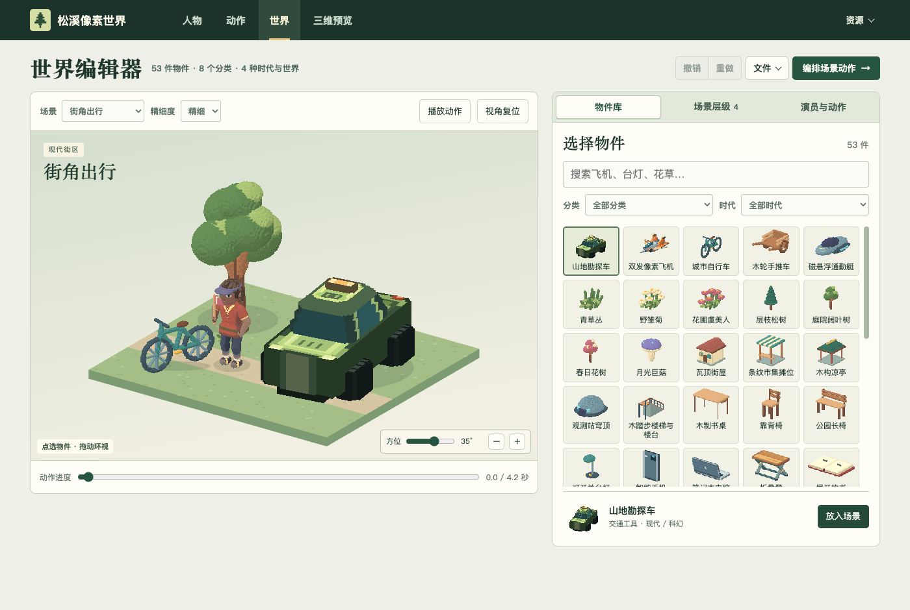
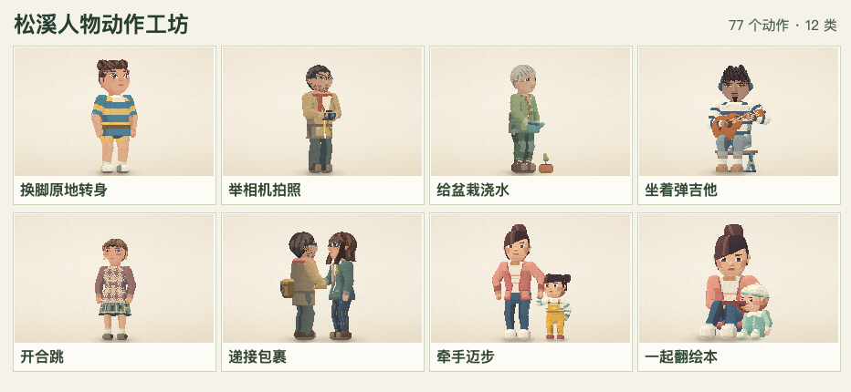
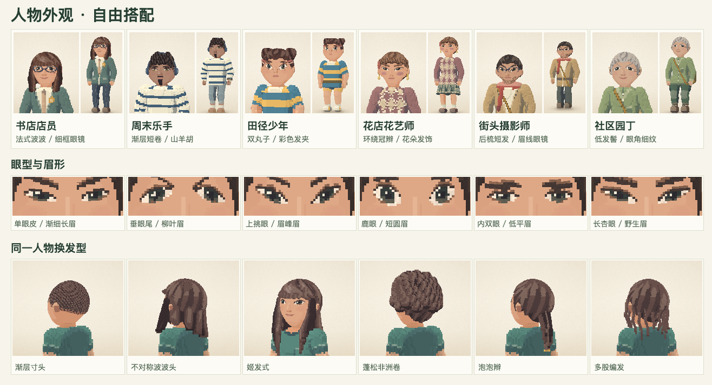
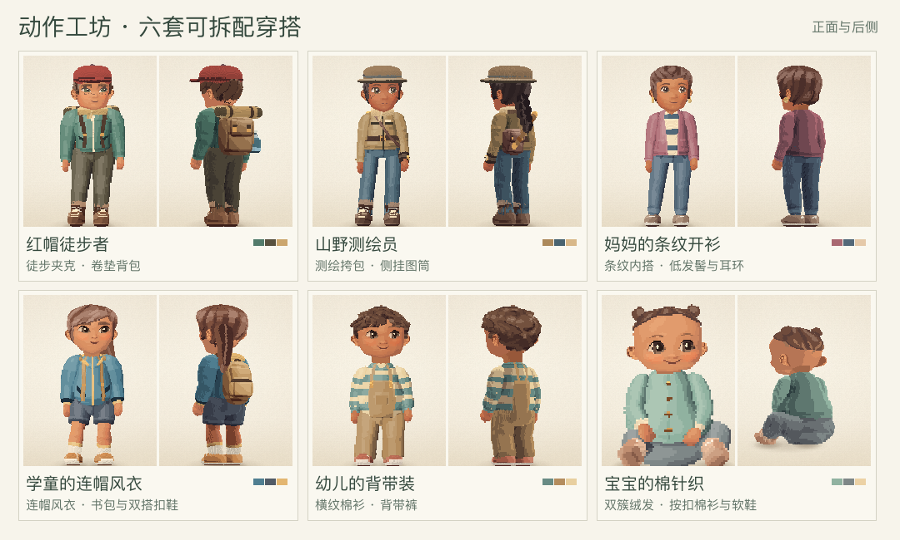
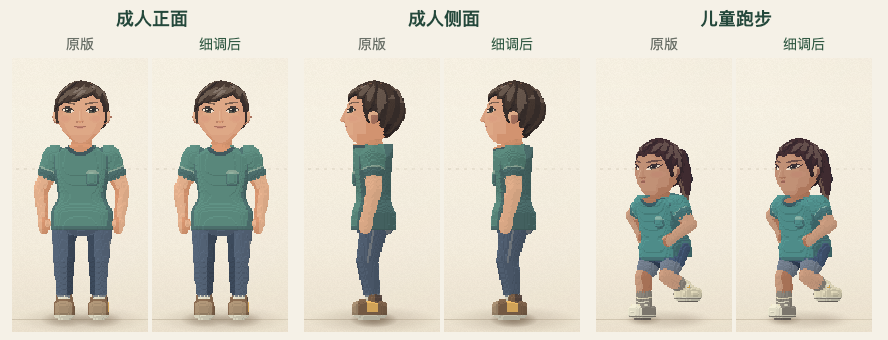
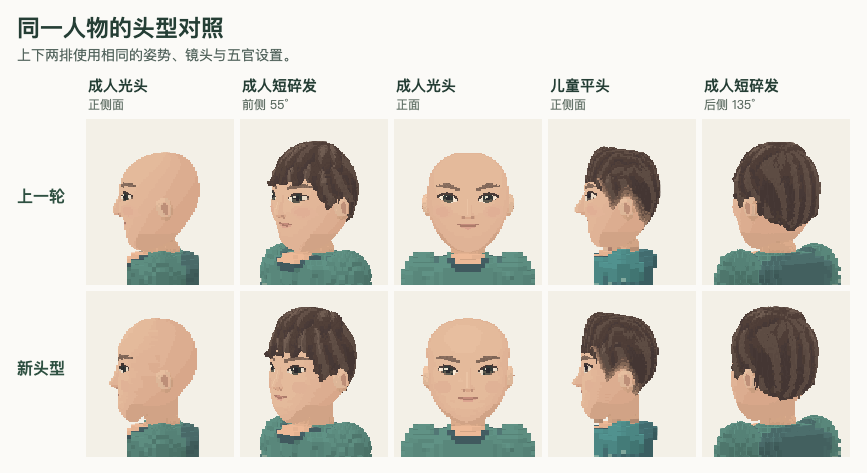
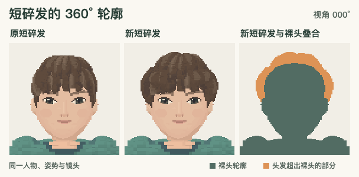
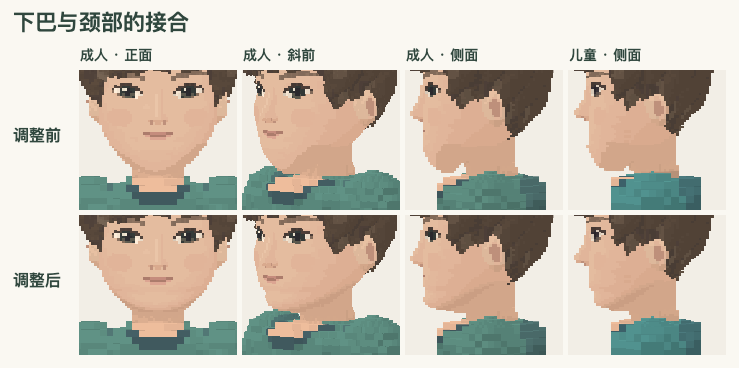
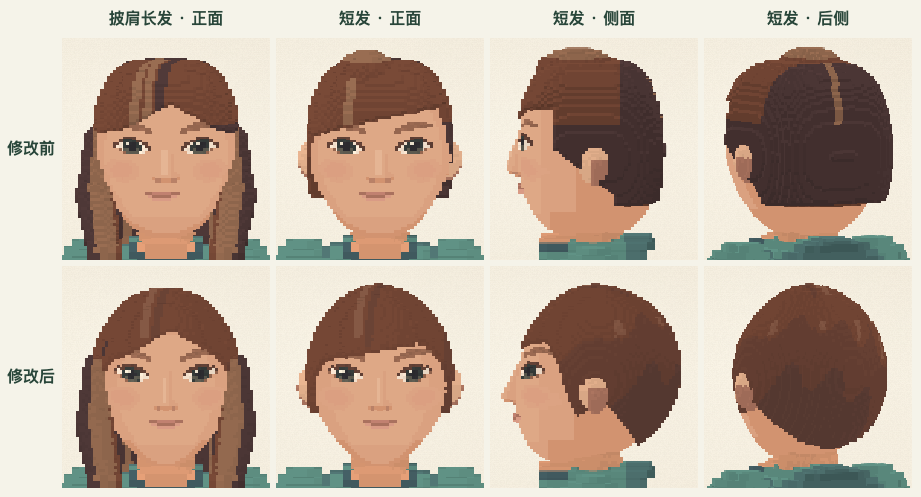
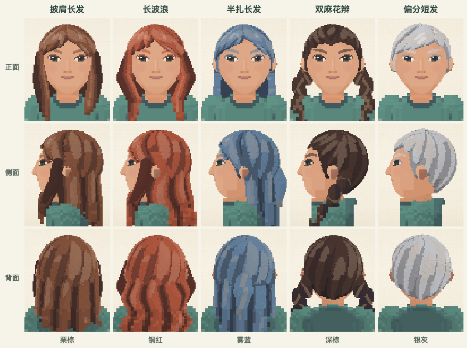

# 松溪像素世界 · Pine Pixel World

用二维像素切片搭建能 360° 环视的小世界。可以设计演员、编排动作，把桌椅、车辆、花草和建筑放进同一场景，再用 Canvas 或 Three.js 播放。工具、原创人物、动作与场景物件使用 MIT 许可证。



## 本地运行

在仓库根目录启动静态 HTTP 服务，无需构建或安装前端依赖。Three.js 随项目分发。

```sh
python3 -m http.server 8000 --bind 127.0.0.1
```

1. 在人物创作室打开形象库，选人物、调五官和穿搭。点「保存形象」把配方收进「我的形象」。同一浏览器标签页会暂存未保存的草稿。「用此人物编排动作」把当前人物、搭档和试演动作放入时间线。[人物创作室](http://127.0.0.1:8000/atelier.html)
2. 在动作工坊按姿势卡片试看，用「加入末尾」添加动作。时间线可以选段编辑、排序和循环。「把编排放进世界」打开这份编排的场景。从场景带入的编排可以送回原场景。[动作工坊](http://127.0.0.1:8000/studio.html)
3. 在世界编辑器选择九个示例场景之一，或布置自己的场景。点画布里的物件可编辑位置与归属，拖动画布可环视。建筑的「看内部」与楼梯的「布置楼台」在场景层级里。[世界编辑器](http://127.0.0.1:8000/index.html) · [亭中小憩](http://127.0.0.1:8000/index.html?scene=pavilion)
4. 点顶部「三维预览」检查当前动作或场景。暂停时打开会停在同一姿势，「返回」可继续编辑。[三维预览](http://127.0.0.1:8000/three.html)

三个编辑器都支持撤销、重做，文件菜单可导入或导出 JSON。窄屏保留实时小预览，点「预览」可展开画面与播放控制。「资源」收录接入规范和原始演示。[松溪步道](http://127.0.0.1:8000/trail.html) · [原始人物切片](http://127.0.0.1:8000/slice-study.html)

## 形象、动作与物件

人物创作室从 1.16.0 起默认采用「游戏立绘」。在「画风」切换到「漫画」，同一个角色会有更舒展的眼睑、更大的虹膜和更简洁的鼻尖与下颌轮廓。想保留原来的绘法可以选「自然」。在「五官」点「挑一组脸」，一次比较同一肤色、发型与穿搭下的四张脸，再选一张继续捏。成人、儿童和婴儿都可以使用这三种画风。[打开漫画选脸](http://127.0.0.1:8000/atelier.html?preset=look_relay&tab=face&portrait=manga&candidates=1&bearing=27) · [同一人三种画风与连续八次随机结果](portrait-art-preview.png) · [人物画风接口](appearance-standard.html#portrait-art)

形象库含 59 套可拆开的配方。可按时代、职业、姓名或配件搜索，再更改发型、肤色、衣装、佩饰和手持物。现代职业包括程序员、开发工程师、经理、售货员、导游、护士和飞行员。古代、奇幻和科幻系列可以互相借用部件。成人、学童、幼儿和婴儿各有适合身材的骨架。工坊最初的六位演员也从普通配方生成。已有编排仍可通过 `hiker`、`surveyor`、`mother`、`child`、`toddler` 和 `baby` 找到他们。

在「五官 → 下巴与下颌」可以选自然短颌、柔圆、微尖、方正，再调颏尖高低、前伸、圆钝程度、下颌后角的位置与颌颈转折。勾选「显示接点」后选「点头回应」，侧面能看到固定在躯干上的领口、颅底的旋转支点以及下巴接入前颈的位置。1.9.2 及更早的存档保留原骨架和轮廓。[试调下颌](http://127.0.0.1:8000/atelier.html?preset=look_body_male&tab=face&bearing=90&points=1&action=nod) · [同镜头形状对照](jaw-controls-preview.png) · [侧面点头与接点动画](jaw-pivot-preview.gif)

1.10.1 新增左右耳前的下颌关节。「侧面试张口」会显示下颌从耳道前下方经过下颌角到颏尖的走向。上唇与头骨一起保持稳定，下唇与下巴绕耳前的轴向下运动，较大张口时关节会稍向前滑。打哈欠和双人交谈也使用这个动作通道。已有 1.10.0 人物可在「五官」预览升级。[打开张合嘴演示](http://127.0.0.1:8000/atelier.html?preset=look_body_male&tab=face&bearing=90&points=1&action=open-mouth&play=1) · [正侧面张口动图](jaw-hinge-preview.gif)

1.11.0 按参考网格的前后径与头宽重配头型。打开「五官 → 侧面轮廓」，用「头部前后径」调额头到后脑的距离，用「面部起伏」调鼻根、颧颊和颏尖的体积。要单独改变下巴的位置，可在「下巴与下颌」调「下巴前后」。1.10.1 存档可点「试用新侧面轮廓」，满意后保存。[裸头侧面](http://127.0.0.1:8000/atelier.html?preset=look_body_male&tab=face&hair=bald&bearing=90) · [短发斜前视角](http://127.0.0.1:8000/atelier.html?preset=look_body_male&tab=face&hair=crop&bearing=45) · [同镜头的正侧面和全身对照](head-depth-preview.png)

1.11.1 轻轻收平耳后最凸的一段。裸头和短发沿同一条新弧线贴合，后脑的丰满程度可在「五官 → 侧面轮廓 → 后脑深度」调节。1.11.0 的存档可点「试用微收后脑」预览。[两版后脑轮廓叠看](occiput-profile-preview.png)

1.12.0 在「五官」提供 14 项连续调整。颧骨可以调高低、宽度和前凸，下颊可以单独变瘦或变饱满。眼窝、眼裂、眼睑、眼尾、眉眼距离、鼻梁、鼻翼和上下唇可与任意肤色、发型、体型搭配。5 组颧颊起点可与 15 组五官组合交叉使用，例如给「低颧饱颊」配上「深眼窝 · 宽鼻翼」。职业形象也由这些普通配方组合。[试用这组搭配](http://127.0.0.1:8000/atelier.html?preset=look_body_male&tab=face&cheeks=low&features=deep-wide&bearing=36) · [正面与斜面对照](face-morph-preview.png)

「随机人物」默认选配成对的眉眼、鼻唇和完整穿搭，再小幅改变五官。生成器为眉眼、鼻唇留出间距，并协调颧骨和下颊。肤色独立抽取。在「随机设置」里选「特征鲜明」可以加大变化，也可以分别锁定体型、肤色、发型与发色、穿搭与配饰。「随机五官」只换当前人物的面部。连续生成后可点「撤销随机」回到原草稿，选中喜欢的形象后点「保存形象」即可带进动作工坊。[生成一个人物](http://127.0.0.1:8000/atelier.html?tab=face&random=1) · [形象生成接口](appearance-standard.html#face-morphs)

1.13.0 为婴儿单独采样头骨、眼位、唇线和耳位。婴儿有更高的额头、较短的鼻和下巴，淡眉和细软的短发顺着头型生长。「五官 → 婴儿五官」有圆眼浅笑、杏眼小嘴、弯眼丰唇三组起点。选中婴儿后可点「随机五官」试脸，也可在随机设置锁定体型后生成整个人物。旧婴儿存档可点「试用婴儿头型」，满意后保存。[打开婴儿五官](http://127.0.0.1:8000/atelier.html?preset=look_workshop_baby&tab=face&bearing=35) · [旧版婴儿、新版婴儿与学龄儿童对照](infant-head-preview.png)

1.13.1 重画了婴儿耳后到脖子的弧线。枕部最凸处略收，下方沿参考头型逐渐过渡到后颈，细发和反折棉帽也随头型贴合。打开 1.13.0 的婴儿存档，可以在「五官」里点「试用婴儿后脑曲线」，旋转查看后再保存。[看裸头正侧面](http://127.0.0.1:8000/atelier.html?preset=look_workshop_baby&tab=face&hat=none&hair=bald&bearing=90) · [看调整前后对照](infant-nape-preview.png)

1.14.0 调整了成人、学童和幼儿的侧脸。眼睛随眼窝转向太阳穴，嘴角顺着脸部向后收，正侧面也能看到闭合的唇线。下颌的阴影从下巴延伸到耳下。短碎发、侧分和精灵短发的额前发束有了长短差。打开 1.12 或 1.13 系列的旧人物，可以在「五官」里点「试用自然侧脸」，旋转查看后再保存。婴儿沿用独立头型。[旋转查看溪谷学童](http://127.0.0.1:8000/atelier.html?preset=look_fern&tab=face&bearing=90) · [同一人物四个角度的调整前后对照](natural-profile-preview.png)

1.15.0 在「五官 → 嘴唇与下颌线」加入两个独立滑杆。转到正侧面，可以比较上唇、下唇相对鼻尖和下巴的位置。转到斜侧面，可以看见下巴到耳下这段轮廓如何从柔圆变得清晰。成人默认轻微收唇，婴儿的调节幅度更小。打开 1.14.0 存档后可以先试调，点「保存形象」才会写入存档。[在同一人物上试调](http://127.0.0.1:8000/atelier.html?preset=look_body_female&tab=face&hair=side-part&bearing=90&lipProjection=-0.30&jawDefinition=0.45) · [同一张脸的两项滑杆对照](lip-jaw-profile-preview.png)

随机生成时，低颧也可以配清瘦的下颊。方圆脸、梨形脸等在嘴角一带本就较宽，生成器会相应减少这里叠加的饱满度。已有角色可以在「五官 → 颧骨与脸颊」点「收顺面颊」，转到斜侧面看效果，满意后保存。手工预设「低颧饱颊」仍可用来设计更丰满的脸。[55° 随机试脸](http://127.0.0.1:8000/atelier.html?tab=face&random=1&bearing=55) · [同一随机人物的三个角度](cheek-contour-preview.png)

物件库含 53 件素材，分为交通、植物、建筑、家具照明、书写数码、日用文娱、职业器具与奇幻科技装置。用途与时代可以交叉筛选。勘探车和双发飞机复用了原始 28 层图像。新增家具和手持物共享人物动作使用的绘制坐标，可注册新的物件类型。[物件与场景规范](world-standard.md) · [开发者工作日](packs/office-world.json)

世界图鉴默认精细显示人物与场景物件。场景上方可切换为「标准」，所选精细度随场景保存。转动镜头时，前方的桌腿或亭柱能遮住人物，透过空隙仍可看到后方。也可用链接参数 `detail=figure` 或 `detail=standard` 指定起始精细度。[打开书桌场景](http://127.0.0.1:8000/index.html?scene=study&detail=figure) · [凉亭遮挡前后对照](scene-occlusion-preview.png)

凉亭、街屋、摊位和穹顶可以容纳人物与物件。「场景层级」显示每件物品归属哪座建筑，移动或旋转建筑会带动里面的布置。布置好桌椅后也可以添加凉亭，选中它并点「将范围内的人物和物件移入」。[打开亭内视图](http://127.0.0.1:8000/index.html?scene=pavilion&inside=0) · [全景与亭内对照](pavilion-interior-preview.png) · [层级数据规范](world-standard.md#建筑空间与层级)

演员走进条纹市集摊位会踏上底座，走出后回到地面。旧场景中仍在根层的演员也会自动贴合地板。[查看摊位内部](http://127.0.0.1:8000/index.html?scene=market&inside=0) · [鞋底接触前后对照](stall-floor-preview.png)

「楼梯与二层露台」有 14 级木踏步。人物走到二层、转身停留，再走回楼下。拖动进度条可以检查每一步，也能把动作绑定到自己摆放的楼梯上。[播放上下楼梯](http://127.0.0.1:8000/index.html?scene=stairs&play=1) · [停在二层平台](http://127.0.0.1:8000/index.html?scene=stairs&phase=0.5) · [实机动图](stairs-walk-preview.gif)

## 动作工坊

动作库提供 112 个动作，分为 21 类。开发者可以坐到场景中的书桌前打字，售货员能给包裹扫码，导游能举旗，书生能临帖，航行员能采集环境读数。可以按人物、分类和关键词查找，也可以展开「按姿势挑动作」查看当前演员的实际姿势。点卡片即可试演。单段和整套编排都能设置循环，时间线支持变速、重复、换演员、导出和导入。[打开操场热身](http://127.0.0.1:8000/studio.html?demo=training) · [打开陪宝宝玩](http://127.0.0.1:8000/studio.html?demo=nursery)



| 分类 | 例子 |
| --- | --- |
| 移动、姿势与休息 | 侧步、上下楼梯、倒退、原地转身、盘腿、单膝跪地、仰卧小憩 |
| 日常、手势与情绪 | 刷牙、吃饭、梳头、打哈欠、思考、摇头、低头擦眼角、鞠躬 |
| 现代生活、学习与工作 | 接电话、举相机拍照、电脑打字、捧书翻页、写字、举手发言 |
| 家务、运动与舞蹈、音乐与游戏 | 扫地、浇花、搬箱、搅拌、开合跳、单脚平衡、舞步、吉他、玩具鼓 |
| 双人、亲子、婴幼儿 | 握手、碰拳、递接包裹、轮流交谈、牵手迈步、一起翻绘本、滚球、俯卧抬头 |

工坊内置 18 套循环编排。按主角与搭档两种位置统计，成人可参与 106 个动作，学童 104 个，幼儿 53 个，婴儿 25 个。手机沿用人物选好的外壳。书、相机、扫帚和吉他等道具由相应动作带入。握手会按两个人的臂长寻找双方够得到的位置，包裹在交接时转到另一人手上。[试演递接包裹](http://127.0.0.1:8000/studio.html?actor=surveyor&action=handover&partner=mother&play=1) · [导入带两个自建人物的周末来访编排](packs/weekend-visit.json) · [动作接口和关键帧规范](motion-standard.html#actions)

## 自由搭配人物外观

创作室当前在 30 个部位提供 302 款外观，含光头、16 款内置帽子，颜色、卸下部件和整套搭配另计。可以选一份职业或家庭形象配方，更改年龄、穿搭与五官，再另存为自己的角色。[试改书店店员](http://127.0.0.1:8000/atelier.html?preset=look_style_reader&tab=face) · [下载同一人物的 JSON](packs/style-reader.json)



| 部位 | 可单独修改的内容 |
| --- | --- |
| 五官 | 16 种眼型、14 种眉形、12 种鼻形、12 种唇形和 7 种脸型。虹膜纹理、雀斑、笑纹等肌肤特征、妆容和胡须各占一个部位，可叠加。 |
| 头发 | 42 款，按短发、中长发、束发、卷发和编发筛选。可以同角度比较头型，再选择 20 种预设发色或自定义颜色。 |
| 衣物 | 32 款上衣、13 款下装、14 款鞋、8 款颈饰和 16 款内置帽子。15 套穿搭可以拆开修改。 |
| 配件 | 10 款眼镜、8 款发饰、7 款耳饰、7 款腕饰和 10 款包。另有 5 款挂饰、12 款手持物、5 款水壶，以及耳机、助听器、腰带、胸针、手套和背包外挂。 |
| 配色 | 26 个 RGB 色槽。左瞳、眉毛、嘴唇、胡须和妆容可单独染色，肤色、瞳色、唇色和发色共备有 51 个色样。 |

在「查找款式」输入“鱼骨辫”“无框眼镜”或“雀斑”，点结果就能直接试用。在「五官 → 比较五官局部」可以用当前人物的肤色和脸型并排查看眼、眉、鼻、唇。换装后可直接试演喝水、看手机、打字或双人击掌。

## 试穿动作工坊的衣服

在动作工坊选一位演员，点「编辑穿搭」，或在创作室打开「穿搭」。点套装可以给当前人物整套换装，也能单独挑夹克、背带裤、鞋帽和背包。在「配色」里可以分别染上衣、裤子、鞋、包、镜框和水壶。[试穿山野测绘员](http://127.0.0.1:8000/atelier.html?preset=look_workshop_surveyor&tab=wear&bearing=30) · [完整角色 JSON](packs/workshop-surveyor.json)



登山包和书包有双肩带。测绘挎包从一侧肩膀跨到另一侧腰胯。卷垫和图筒可以自由换挂。眼镜跟头转动，腕表跟着手，随身水壶在跑步时挂在包侧或腰间，喝水时从挂点移到嘴边。手机和笔记本在相应的动作里使用所选外壳。六套穿搭均可套用到其他演员。选择「幼儿」或「婴儿」体型时，服装会按对应的骨长、肩宽和四肢比例绘制。

## 试演两个独立的形象

1. 打开创作室，在「默认体型」选择女、男、儿童、幼儿或婴儿。两种成人体型有各自的肩线与腰胯轮廓，三个儿童年龄层均使用中性体型。切换时会保留已选的五官、发型、衣服、颜色和比例滑杆。把其他体型改成婴儿时，创作室会清除胡须和眼角细纹。
2. 打开「发型」，可以转到侧面或背面比较披肩长发、长波浪和双麻花辫。点击色块试染 20 种发色，也能用「自定义发色」选任意 RGB 颜色。换发型会保留当前发色。[试戴披肩长发](http://127.0.0.1:8000/atelier.html?preset=look_body_female&tab=hair&hair=shoulder-length)
3. 给人物取名并保存。改变发型或服装，再点「另存为新形象」。两个存档拥有各自的稳定 ID。
4. 用「对照人物」选择另一个形象，试跑或相互击掌。导出角色 JSON 可以在另一台设备重新打开，文件内含所穿外部帽饰的版本、素材和声明。
5. 也可以直接把 [放学后的双人编排](packs/after-school.json) 导入动作工坊，试看跑步、跳跃、击掌与喝水的完整循环。

「体型」面板以每种默认体型为 100%。身高可调至 75%–130%，肩宽 70%–135%，臂长和腿长各为 80%–125%，步长均为 1%。1.9.0 的裸头站姿成人约为 119–207 cm，儿童约为 85–147 cm。已有形象首次使用扩展范围时会自动采用所需的基础部件版本。

全身和脸部镜头默认开启「精细人物」。全身沿用五官编辑的头脸切片，衣领、手、裤脚和鞋也会加密。动作工坊和 Three.js 观景台也使用精细全身。[查看全身](http://127.0.0.1:8000/atelier.html?preset=look_body_female&tab=shape&hair=shoulder-length&bearing=16) · [同一全身镜头的前后对照图](full-body-detail-preview.png)

`pine-core 1.6.1` 沿用 Q 版的头身比和骨架。后脑向颈部稍稍收拢，肩和上胸的外沿更圆，前臂与小腿在关节附近逐渐收细。下图的每一对都取自相同的镜头和动作帧。



全身镜头有固定的地面和厘米标尺。身高读数取站直时的裸头顶位置。拖动「环视」可以从正面和侧面看两种成人体型的差别。两个样本使用相同的身高、发型和衣装。[成人体型并排对照](http://127.0.0.1:8000/atelier.html?preset=look_body_female&compare=look_body_male&tab=shape) · [儿童身高对照](http://127.0.0.1:8000/atelier.html?preset=look_chorus&compare=look_relay&tab=shape) · [双马尾后侧近景](http://127.0.0.1:8000/atelier.html?preset=look_chorus&tab=hair)

`pine-core 1.9.0` 的成人和儿童头型分别取样自 MakeHuman 的开放模型。每种头型取 29 个水平截面，对齐下巴、嘴和眼睛后，再按原角色的骨架绘成像素。单人近景使用固定取景，调后脑、换发型或转身时可以直接比较脸的大小。[头型数据与采样方法](appearance-standard.html#head-reference) · [从正侧面试光头](http://127.0.0.1:8000/atelier.html?preset=look_body_male&tab=hair&hair=bald&bearing=90) · [从前侧试短碎发](http://127.0.0.1:8000/atelier.html?preset=look_body_male&tab=hair&hair=crop&bearing=55) · [从侧面试儿童平头](http://127.0.0.1:8000/atelier.html?preset=look_relay&tab=hair&hair=crew&bearing=90)



`pine-core 1.9.1` 调整了全部九款短发。圆寸只比裸头多一层薄发，平头在耳上渐短。短碎发的额前与鬓角各有向外挑起的发束，偏分两侧的发量也不同。转面图用橙色标出头发超出裸头的部分。[旋转查看短碎发](http://127.0.0.1:8000/atelier.html?preset=look_body_male&tab=hair&hair=crop&bearing=65)



`pine-core 1.9.2` 把下巴底面和上颈绘在同一组连续截面里。成人从下唇下方略微内收，再转过颏尖接入颈部。儿童的下巴较浅，两侧更圆。1.9.1 存档可在「五官」点「试用新下颌」，保存后采用新版。[查看成人侧脸](http://127.0.0.1:8000/atelier.html?preset=look_body_male&tab=face&bearing=90) · [查看儿童侧脸](http://127.0.0.1:8000/atelier.html?preset=look_relay&tab=face&bearing=90)



「发型」和「五官」共用「后脑深度」滑杆，100% 为新头型的默认值，可在 80%–120% 之间微调。旧存档可先试用当前头型，喜欢后再保存。12 种唇形用脸部切片上的色差画出，水壶对准唇心。[查看唇部侧面](http://127.0.0.1:8000/atelier.html?preset=look_body_female&tab=face&bearing=90)



## 角色与动作怎样复用

先确定骨长与关节，再在各部位的局部坐标中绘制体积。在每个姿势中，用格点采样身体和衣服。Canvas 路径按观察方向层叠像素切片。Three.js 适配器提取同一份格点的可见表面，支持遮挡和阴影。角色导出的是参数和部件引用，动作由独立的采样器根据骨架、标签与接触点重建姿势。

动作根据槽位选择演员。自建成人可带儿童牵手或给宝宝看摇铃，学龄儿童可作为牵手、共读的搭档。自建成人和婴儿也能搭配表演抱起轻摇与躲猫猫。创作室会显示实际试演搭档，进入动作工坊或 Three.js 时沿用这对演员。

角色 JSON 锁定所需的部件库版本。打开旧存档会还原当时的五官、衣服和体型。给旧人物选用这次新增的款式，再点「保存」时，才会把新搭配写进存档。希望保留原件时可选「另存为新形象」。旧成人角色仍可选择自己的默认体型。

基础部件 `pine-core 1.6.0` 用有厚度的发束塑造额前的刘海。短碎发的发尾高低错落，披肩长发沿分缝落向两侧，马尾从发际向后梳。转动镜头可以看清发束之间露出的额头。发根的阴影和发束的亮面都取自 `colors.hair`，自定义染色也能保留层次。[查看额前发束](http://127.0.0.1:8000/atelier.html?preset=look_body_female&tab=hair&hair=crop&bearing=25)



| 想做的事 | 文档或示例 |
| --- | --- |
| 编写和验证形象 | [形象与部件规范](appearance-standard.html) · [角色 Schema](character-v1.schema.json) · [溪谷学童](packs/creek-child.json) · [枫林信使](packs/maple-child.json) · [双马尾合唱队员](packs/chorus-child.json) · [单马尾接力跑手](packs/relay-child.json) |
| 导入同身高、同装的成人样本 | [女体型 JSON](packs/female-adult.json) · [男体型 JSON](packs/male-adult.json) |
| 贡献一顶帽子 | [溪谷帽饰 JSON 原稿](packs/creek-hats.json) · [部件包 Schema](part-pack-v1.schema.json) |
| 贡献动作或导出编排 | [骨架、接触点与动作 API](motion-standard.html) · [动作编排 Schema](score-v1.schema.json) · [可移植角色编排包 Schema](cast-v1.schema.json) |
| 接入 Three.js | [人物适配器](pine-three.mjs) · [示例集成](three-demo.mjs) |

## 兼容性检查

使用 Node.js 22 或更新版本。在项目根目录运行以下检查。最后一项调用本机 Chrome，Linux 默认使用 google-chrome，可通过 CHROME_BIN 指定可执行文件。GitHub Actions 在推送和拉取请求时运行这些检查。

```sh
node check-motion.cjs
node check-appearance.cjs
node tests/check-world.cjs
node tests/check-atelier.cjs
```

检查涵盖内置动作与演员标签、时序和接触点，还会在独立运行环境中验证形象的逐像素还原、部件版本和冲突处理。贡献新帽子时应为新版本保留唯一的包名与版本组合，分别检查儿童和成人佩戴时的正面、侧面与后脑。

## 许可

本项目原创工具、人物、部件、动作、场景及示例按 [MIT 许可证](LICENSE) 分发。版权为 2026 zhangran653 and contributors。复制或分发时请保留版权与许可声明。随附 Three.js r187 与 OrbitControls 的版权属于 three.js authors，[上游许可](vendor/three-r187/LICENSE) 已保留。外部导入的部件包保留包作者的声明。
