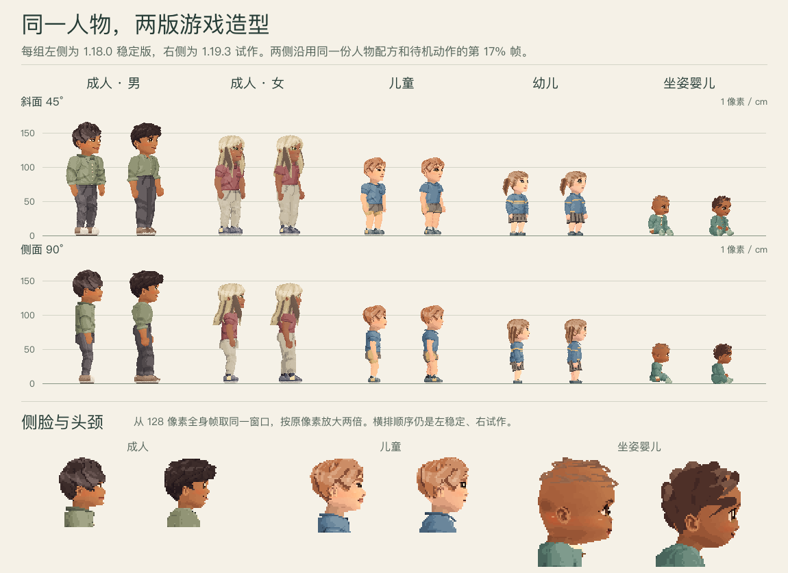

# 游戏人物捏脸研究与 1.19.3 试作

**推荐采用 Ryzom 的脸形变形方法。** 由美术先完成一张可以转动的中性脸，再塑出几个可控的变化；角色配方存基型和变化的权重。现有动作关节负责点头、走路和道具接触。角色在游戏中的轮廓和明暗由原创美术决定。1.19.3 已把这个方法接入创作室，与 1.19.2 的结构试作共用动作系统。[结构试作实拍](layers.webp) · [同配方游戏尺寸对照](comparison.webp)

### 在原有角色上量到什么

取造型对照台的黄帽橙衫样本 04，用 1.19.2 的自然待机第 17% 帧，按人物从鞋底到帽顶高 64 像素换算。模型上两眼中心横向相距约 7.0 像素，眼到嘴纵向约 5.1 像素，上下唇接点的高差仅 0.73 像素，下唇到颏尖也只有 2.54 像素。这是接点投影距离，实际着色还受取样和遮挡影响。在这个镜头里，一格错位就可能让嘴线粘住下巴；更细的内部头骨无法替美术决定该留下哪一格。[样本实拍，末行](comparison.webp)

## 核对过的参考

| 参考 | 原作如何处理 | 对本项目的取舍 |
| --- | --- | --- |
| Ryzom，已发行的开源 MMORPG | 客户端读取八个面部形变值，支持按当前基型配置的上下限换算为权重。玩家可以在创建界面转到侧面调鼻、嘴和下巴。 | 借鉴完整头模与有限形变。脸长、下巴和唇下转折可以做成成组的变化。我们的成人、儿童、婴儿需要各自的原创基型。[客户端实现](https://github.com/ryzom/ryzomcore/blob/a60e78c573b44855d57a50b165bd9397897bd29b/ryzom/client/src/player_cl.cpp#L970-L1016) · [开发者的形变图解](https://github.com/ryzom/ryzomcore/wiki/characters) · [角色创建实机界面](https://shared.fastly.steamstatic.com/store_item_assets/steam/apps/373720/manuals/The_Ruins_of_Silan_-__Starter_Guide.pdf?t=1665778990#page=4) |
| Blender Studio《Sprite Fright》，开放动画短片 | Ellie 的脸从正面呈圆形，侧面有前后方向，眼睛周围较平，后脑给发量留空间。作者也公开了仅在特定摄影机角度成立的嘴型。 | 取多角度设计方法。游戏中的嘴沿面部曲面着色，保留实物的侧面厚度和遮挡，方便玩家绕头观察。[作者的三视角轮廓拆解](https://studio.blender.org/blog/sprite-fright-the-illusion-of-simplicity/) |
| Veloren 0.18.0，已发行的体素 RPG | 实际读取两个人类裸头及各自默认眼部和首个有形发件，按官方坐标合并投影。两个裸头占用范围都是宽 14、深 8、高 8 个体素。此组合的眼睛、眉毛、发髻清楚，纯侧面鼻唇层次很少。 | 借鉴有体积的可换发件和配色。希望保留的鼻唇颏细节需要在本项目的实际尺寸下专门绘制。[原始部件清单](https://github.com/veloren/veloren/blob/v0.18.0/assets/voxygen/voxel/humanoid_head_manifest.ron#L2-L88) · [组装源码](https://github.com/veloren/veloren/blob/v0.18.0/voxygen/src/scene/figure/load.rs#L318-L419) |
| Stendhal，2D 像素 MMORPG | Cabbit 人形基底用四个方向和少量行走帧。作者公开了原始小尺寸图以及转向预览。 | 在原生游戏尺寸看头身比例、衣袖与手的分界和站姿。我们的切片还需要在两个主方向之间连续旋转。[基底及四向预览](https://opengameart.org/node/84455) · [游戏换装界面](https://stendhalgame.org/wiki/Stendhal/manual/Gameplay#Outfit) |

项目内继续使用原创模型、像素和代码，按 MIT 发布。Ryzom 的代码与美术有各自的许可，Veloren 的素材也有项目署名和许可约定。参考文件保留在上游。[Ryzom Core 许可](https://wiki.ryzom.dev/) · [Veloren 美术贡献说明](https://book.veloren.net/contributors/artists/index.html)

## 在现有切片里的实现路径

1. **先做两个人物。** 一位短发成人暴露脸颊与下颌，一位坐姿婴儿暴露脸和颈的衔接。先画正面、斜面和纯侧面的像素稿，同时确定头与肩、躯干和双手的比例。每张稿都回到 64 和 128 像素全身尺寸看。
2. **用同一张连续表面承接这些稿。** 每个年龄单独建头。在同一基型内，中性形和各目标脸使用相同的顶点对应关系。例如一个「短软下巴」目标同时塑出颏尖、下唇下缘与下颌底线。眼睑、嘴线与面颊色块固定在同一表面，太阳穴和耳后给独立发件留出厚度。
3. **把设计好的脸转换为切片。** 在改配方时混合表面并采样为带材质索引的水平像素层，复用现有切片投影和人物配色。用分组的明暗、清楚的瞳孔和嘴线重新检查小尺寸效果。游戏运行时可以缓存同一身份的静态头形，眨眼、微笑和张嘴则走单独表情。
4. **从完整配方附近随机。** 先抽年龄和通过审看的基型，再在该基型已验证的组合内变化。肤色、发色、身份与职业独立。对同一批固定种子同时保存正脸和侧脸，观察眼睑、唇颏关系和头身比例。成人的捏脸极值与婴儿分开设定。

## 可运行的 1.19.3

四个年龄分别绘制水平截面。每一圈用同一组位置描述中线、眼颊转面、太阳穴和后缘，再在同一年龄的形变目标之间调整。眼睑与虹膜共用弧面，鼻梁、鼻尖、唇颏属于连续体表。帽子和头发仍可单独换装。服装和染色可以复用这张脸，逐帧的关节继续承担动作与接触点。[原创切面与像素笔触](../../game-face.js) · [创作室接口](../../appearance-standard.html#game-face)

用同一配方、同一待机帧实际渲染成人和坐姿婴儿的正面、22.5°、45°、67.5°、侧面和背面。成人头像裁自 256 像素全身，婴儿头像裁自 128 像素坐姿。单独将成人挥手、婴儿伸手和历史黄帽样本渲染至 64 像素定标的画布。两版共用比例尺，婴儿坐矮时保留身高差。[六向和游戏尺寸对照](game-faces.webp)

盲评每个年龄八个固定种子。每组先生成一份配方，再分别交给两版绘制。下图直接取各年龄的前两个种子，包含帽檐、深色肤色、浅色头发和不同外套。64 像素全身的正侧面仍可能只有一格唇色，是否合意由实际审看决定。[八名连续随机人物](game-random.webp) · [打开盲评](../../figure-study.html?mode=blind)

运行 `node tests/check-game-face.cjs` 检查模型闭合、形变差异、唇面转折、128 份配方的种子复现、婴儿双脚着地和 Three.js 表面。运行 `node tests/check-figure-study.cjs --bench` 在本机对照同一成人走路时两版的取样与投影耗时。

在本机的无界面 Chrome 中，两版各取 20 个成人走路帧，交替测量。姿态与精细切片生成的中位数分别为 61.1 和 58.2 毫秒，绘制与读回为 2.3 和 2.5 毫秒。相机、角色和画布尺寸相同，结果只描述这次单角色测量。

## 在游戏尺寸上检查全身

分龄各取八个固定种子，将 32 组人物的正面、斜面、侧面和背面放在同一比例尺下。儿童 06 的短袖和短裤最容易看出问题。手与大腿相邻时，亮肤色会连成一片。原先短裤的结束截面还缩到了靠近膝盖的粗细，腿部会穿过裤口。试作让肘、腕、膝和掌缘使用随姿势旋转的成片明暗，并按衣袖和裤腿实际覆盖的位置绘制短衣边。下图取同一位儿童待机的四向原色，以及儿童挥手、婴儿伸手的 64 像素画面。两种身体着色共用脸型、动作与关节位置。[同配方四向实拍](painted-figure.webp) · [实时开关对照](../../figure-study.html?subject=child-6&before=finish&size=128)

「独立生成 · 整体人物」另开一组盲评。稳定版 1.18.0 和带有身体色块的 1.19.3 各自使用公开的随机接口，年龄与种子相同。32 组里，按上衣、下装、鞋的款式组合计数，成人两版分别得到 6 和 8 种，儿童 6 和 8 种，幼儿 1 和 5 种，婴儿 2 和 6 种。这是这批样本的搭配数量。前两个种子逐龄直接出图，人物美术的偏好留给看图者判断。原有同配方脸型盲评与这一组分别保存、分别揭晓。[八组真实生成结果](random-cast.webp) · [完整分龄盲评](../../figure-study.html?mode=blind&review=cast&size=128)

同一个短袖儿童（种子 `3418494998`）行走时，两种身体画法各测 20 帧。此机无界面 Chrome 中，生成姿态和精细切片的中位时间从 70.3 到 71.5 毫秒，投影并读回像素从 1.9 到 2.0 毫秒。此计时针对每帧重新采样的单人物。运行 `node tests/check-figure-study.cjs --bench-body` 可在另一台机器上复测。

## 拿正在编辑的人物比较

在创作室点「对照当前人物」，未保存的随机形象也能带入，包括自定义配色、外部帽包、搭档、转向和动作进度。选择「稳定版与全身试作」可以看同一套穿搭在 1.18.0 与 1.19.3 动画基础脸、身体着色下的区别。选择「草稿原版与全身试作」则保留左侧实际使用的版本与画风。双人动作会用搭档来计算当前人物的姿势。两侧各自提供返回编辑的入口。[创作室](../../atelier.html) · [坐姿婴儿的侧脸](../../figure-study.html?subject=baby&before=whole&bearing=270&framing=head&size=128)

下图上两排拍摄同一待机帧，共用地面、机位和每厘米一像素的比例尺。成人男女、儿童、幼儿和坐姿婴儿的显示高度由实际姿势决定。底排先按 128 像素全身定标，再把两侧同一位置的头像裁出、放大两倍。这个取样保留了嘴、下巴和衣领在游戏画面里实际占用的像素数。[互动厘米尺](../../figure-study.html?before=whole&subject=toddler-1&size=world&bearing=315)

